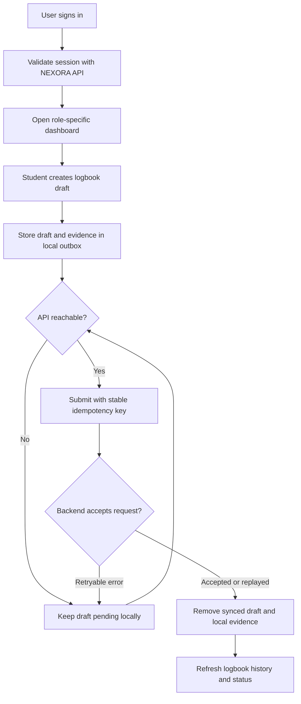

# NEXORA MOBILE

**Flutter client for internship logbook management and academic supervision.**

Flutter · Dart · Material 3 · REST API · SQLite offline outbox

[Backend repository](https://github.com/gusti111/NEXORA-Backend)

---

## Overview

NEXORA Mobile is the Flutter client for a role-based PKL (Praktik Kerja Lapangan) logbook and supervision platform. It connects students, lecturers, field coordinators, and administrators through a shared Laravel REST API.

## Roles and user journeys

| Role | Main capabilities |
| --- | --- |
| **Student (Mahasiswa)** | View placement details, submit daily logbooks, attach photos and optional coordinates, track review status, revise submissions, and read review history. |
| **Lecturer (Dosen)** | Review assigned students' submissions, approve or reject entries, request revisions, and inspect review history. |
| **Coordinator (Korlap)** | Monitor student progress, inspect logbooks and statistics, complete eligible placements, and download PDF / Excel reports. |
| **Administrator** | Manage accounts and placements, review submissions, reset passwords, and inspect platform statistics. |

## Architecture

    Flutter application
       ├── Role-specific screens
       ├── ApiService
       ├── SessionTokenStore
       ├── Offline logbook service and SQLite outbox
       └── Secure file and photo handling
                   │
                   │ HTTPS + Sanctum bearer token
                   ▼
            NEXORA Laravel API

## Mobile submission and synchronization flow

## Technology

- Flutter and Dart (SDK constraint: ^3.11.4).
- Material 3.
- Laravel REST API with Sanctum bearer tokens.
- http for REST and multipart requests.
- flutter_secure_storage for access-token storage.
- shared_preferences for non-secret session metadata and cached profile data.
- sqflite and UUID-based idempotency keys for the offline logbook outbox.
- image_picker and geolocator for evidence attachments.
- path_provider and open_filex for local files and report exports.

## Requirements

- Flutter SDK with a compatible Dart SDK.
- Android Studio / Android SDK or Xcode for iOS development.
- A running NEXORA Backend API.
- A reachable API URL from the target device or emulator.

## Getting started

    git clone https://github.com/gusti111/NEXORA-Mobile.git
    cd NEXORA-Mobile
    flutter pub get

Start and configure the backend by following the [NEXORA Backend setup guide](https://github.com/gusti111/NEXORA-Backend).

### Configure the API URL

The application receives its base URL through the API_BASE_URL Dart define.

| Target | Example |
| --- | --- |
| Android emulator | http://10.0.2.2:8000/api |
| Physical Android device | http://192.168.1.10:8000/api |
| Production | https://api.example.com/api |

For a physical device, replace the LAN address with the development computer's reachable IP address.

    flutter run --dart-define=API_BASE_URL=http://192.168.1.10:8000/api

For a release build, use a real HTTPS API domain:

    flutter build appbundle --release --dart-define=API_BASE_URL=https://api.example.com/api

Do not put passwords, private API keys, bearer tokens, or database credentials in Dart source or build defines.

## Session handling

- Sanctum access tokens are stored using flutter_secure_storage.
- The application validates the session against the backend when starting and when returning to the foreground.
- Unauthorized or inactive-account responses clear the local session.
- Network failures do not automatically delete a cached session.
- Logout attempts to revoke the server token and clears local session data even when the API is unreachable.
- The application uses a five-minute background inactivity timeout.

## Offline logbook drafts

The student submission flow uses a local SQLite outbox:

1. Draft fields are stored under the current account ID.
2. Selected evidence photos are copied into the application's private documents directory.
3. Each draft receives a stable UUID used as the backend idempotency key.
4. Retriable network and server errors remain queued.
5. Successful submissions are removed from the outbox and their copied evidence files are cleaned up.
6. Cached placement and logbook information can be displayed when the server is unavailable.

Synchronization is triggered after login, when the app resumes, and manually from the logbook history screen. This implementation does not run a background worker after the application has been fully terminated.

The queue is scoped by user ID and does not store access tokens. Draft text and copied evidence files reside in the app's private documents area; separate application-level encryption for those drafts is not implemented in this phase.

## In-app notifications

The mobile inbox consumes database-backed notification endpoints from the backend. It supports unread counts and mark-read actions across the four roles.

This is an in-app notification experience. Push delivery through Firebase Cloud Messaging or Apple Push Notifications is not configured in the current phase.

## Verification

    flutter analyze
    flutter test

The repository includes tests for API logbook operations, offline outbox behavior, local storage, and secure token storage. CI is defined in .github/workflows/flutter-ci.yml.

## Repository structure

    lib/
    ├── main.dart
    ├── services/
    │   ├── api_service.dart
    │   ├── session_token_store.dart
    │   ├── offline_logbook_store.dart
    │   └── offline_logbook_service.dart
    ├── screens/
    │   ├── mahasiswa/
    │   ├── dosen/
    │   ├── korlap/
    │   └── admin/
    └── widgets/

## Integration status

A staging runbook and Postman collection are maintained in the backend repository. No staging host is configured by the current repositories, so a completed live integration test should not be assumed.

## Project status

An academic mobile application with role-based workflows, offline draft support, secure token storage, and automated tests. Validate the end-to-end mobile/API contract and device-level file protection before handling real student evidence.

## Author

**Gusty Faqikh** · [GitHub](https://github.com/gusti111)